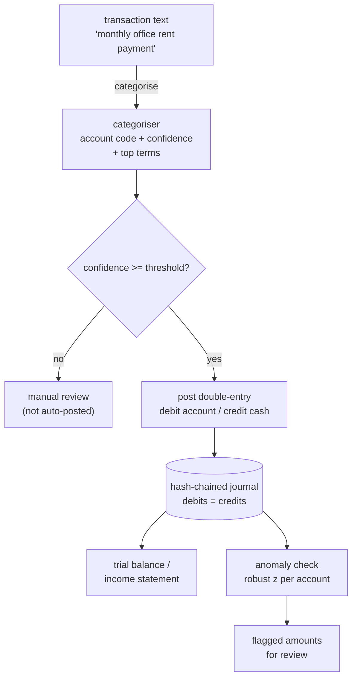

# LedgerSense

A double-entry general-ledger engine with a tamper-evident journal, an
explainable AI transaction categoriser, and statistical anomaly detection for
bookkeeping review. The accounting core is deterministic and auditable; the AI
only *suggests*, it never silently changes the books.

## Why it matters

Most "AI bookkeeping" demos get the accounting wrong: they treat a ledger as a
list of amounts and let a model write to it directly. LedgerSense inverts that.
The core enforces the two things an accountant actually relies on —

- **every entry balances** (total debits equal total credits), and
- **history cannot be quietly rewritten** (the journal is hash-chained),

— and the machine learning sits on top as a reviewer's assistant: it proposes an
account for a free-text charge and explains the proposal, but a low-confidence
guess is routed to a human and the books are only ever mutated through the
validated posting path.

## How it works



1. **Ledger (`ledger.py`).** A `JournalEntry` is a set of debit/credit lines.
   `post()` rejects it unless debits equal credits and every account exists, then
   chains it: `entry_hash = SHA-256(prev_hash + canonical_content)`. Amounts are
   integer **cents**, never floats, so sums are exact.
2. **Categoriser (`categorizer.py`).** A `FeatureUnion` of word (1-2 gram) and
   character (`char_wb`, 3-5) TF-IDF views feeds a logistic regression that maps a
   description to one of nine income/expense accounts. Being linear, it returns
   the words that drove the suggestion.
3. **Anomaly check (`anomaly.py`).** For expense and income categories — where a
   single account's postings are expected to be of a similar size — a **robust
   z-score** (median + MAD, not mean + standard deviation) flags amounts far from
   that account's usual range, so a `$9,400` charge among `$50` software bills is
   caught, with a plain-language reason. Asset/clearing accounts like cash
   aggregate heterogeneous flows and are deliberately not checked this way.

## Quick start

```bash
python -m venv .venv && source .venv/bin/activate
pip install -e ".[dev]"

python -m ledgersense.cli demo          # post activity, categorise, flag an outlier, tamper-test
uvicorn ledgersense.main:app --reload   # HTTP API
```

Example API calls:

```bash
# Suggest an account for a free-text charge
curl -s -X POST localhost:8000/categorize -H 'content-type: application/json' \
  -d '{"description": "monthly cloud hosting invoice"}'

# Record an expense (auto-posts if the suggestion is confident)
curl -s -X POST localhost:8000/expense -H 'content-type: application/json' \
  -d '{"date": "2026-03-01", "description": "office lease payment", "cents": 150000}'

# Trial balance (debits must equal credits) and journal integrity
curl -s localhost:8000/trial-balance
curl -s localhost:8000/verify
```

## Configuration

Settings load from environment variables with the `LG_` prefix (see
`.env.example`):

| Variable                        | Default | Meaning                                              |
| ------------------------------- | ------- | ---------------------------------------------------- |
| `LG_CATEGORISER_MIN_CONFIDENCE` | `0.45`  | Below this, a charge is routed to manual review      |
| `LG_ANOMALY_Z_THRESHOLD`        | `3.5`   | Robust z above which an amount is flagged            |
| `LG_ANOMALY_MIN_CENTS`          | `1000`  | Amounts below this are ignored as noise              |

## Evaluation: honest generalisation, not a memorised 1.0

The categoriser is trained on synthetic descriptions, so a random train/test
split would report a meaningless ~1.0. It would also be easy to *accidentally*
ship an overfit model — and in fact an early version of this project did: a
first generator scored **0.44** on a phrase-disjoint split with a **0.56**
train/test gap. That is template memorisation, and it was only caught by running
the disjoint evaluation rather than trusting the within-distribution score.

The fix was to model descriptions the way real bank/card memos actually read:
each account carries **recurring anchor keywords** ("office rent", "payroll
salary", "software subscription") that, within an account, share partial stems
("lease"/"rent", "software"/"subscription") the way real memos do.
`ledgersense.evaluation` then runs an **anchor-disjoint split**: whole anchor
keywords are held out of training, so the test descriptions centre on merchant
vocabulary never seen in training — the genuinely hard, realistic question of
whether the model can place a charge it has no exact keyword for:

```
$ python -m ledgersense.evaluation
  accuracy (mean+/-std over 6 seeds): 0.89 +/- 0.04   # nine accounts; chance ~0.11; keywords unseen in training
  train accuracy                     : 1.00
  train-test gap                     : 0.11   # bounded -> stem signal, not templates
```

The command averages over several seeds on purpose: a single split can land on a
lucky 0.95, and reporting that would be the same self-deception as the random
split. What this number does and does not claim, stated plainly:

- It **does** claim the model generalises to *unseen keyword phrasings* by
  leaning on shared word stems — "studio lease" is placed as rent because
  "lease"/"rent" recur across the training examples.
- It does **not** claim perfection: a held-out keyword with no stem relative in
  training (a genuinely novel merchant vocabulary) is where the ~11% of errors
  land. Closing that gap needs training on real labelled transactions, not more
  synthetic data; the honest baseline to beat there is this anchor-disjoint
  score, not the within-distribution ~1.0.

Because the model can be wrong, it never posts unsupervised: low-confidence
suggestions go to review, and the ledger's invariants hold regardless of what the
model says.

## Testing

```bash
ruff check ledgersense tests
pytest --cov=ledgersense --cov-report=term-missing --cov-fail-under=80
```

The suite covers the accounting invariants (balanced entries, rejected
unbalanced/invalid entries, trial-balance equality, net income), the hash-chain
tamper detection, the categoriser (including the phrase-disjoint generalisation
check with a bounded gap), the robust-z anomaly detector (outlier found,
too-few-samples and identical-amounts handled), the HTTP API, and the CLI demo.

## Documentation

- `docs/architecture.md` — components, data flow, and the design rationale.
- `docs/adr/` — the main design decisions and their trade-offs.
- `docs/estudio/` — a study guide in Spanish, for learning the project in depth.

## A note on scope

LedgerSense is a reference implementation, not certified accounting software. It
demonstrates a clean, auditable double-entry core with assistive ML done
honestly. A production system would add persistence, authenticated users,
multi-currency, period closing, and training on real labelled transactions.

## License

MIT. See [LICENSE](LICENSE).
