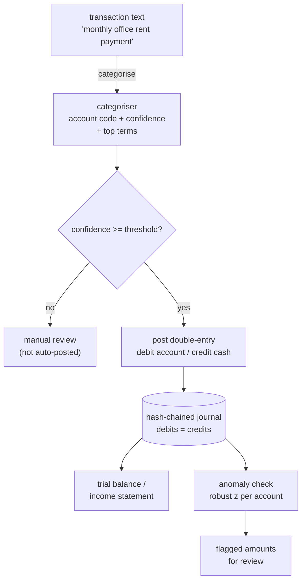

# Architecture

LedgerSense has a deterministic accounting core and two assistive layers (an AI
categoriser and a statistical anomaly check) that sit *beside* the core without
ever being trusted to change the books on their own.

## Components

| Component    | File                      | Responsibility                                          |
| ------------ | ------------------------- | ------------------------------------------------------- |
| Accounts     | `ledgersense/accounts.py` | Chart of accounts, account types, normal-balance rules  |
| Ledger       | `ledgersense/ledger.py`   | Validated, append-only, hash-chained double-entry journal |
| Categoriser  | `ledgersense/categorizer.py` | Free-text description → account code, with explanation |
| Generator    | `ledgersense/generate.py` | Synthetic labelled descriptions + phrase-disjoint split |
| Evaluation   | `ledgersense/evaluation.py` | Leakage-free generalisation measurement               |
| Anomaly      | `ledgersense/anomaly.py`  | Robust-z amount outliers per account                    |
| Service      | `ledgersense/service.py`  | Orchestration: categorise → post → check                |
| HTTP API     | `ledgersense/main.py`     | REST surface over the service                           |
| CLI          | `ledgersense/cli.py`      | End-to-end demo                                         |

## Data flow

## Why money is integer cents

Floating-point money is a classic source of silent corruption: `0.1 + 0.2` is
not `0.3` in binary. Every amount in LedgerSense is an `int` number of cents, so
addition is exact and a trial balance that should be zero is exactly zero.

## Why the journal is hash-chained

Each posted entry stores `SHA-256(prev_hash + canonical_content)`. Editing any
historical entry changes its hash, which no longer matches what the next entry
recorded as its `prev_hash`, so `Ledger.verify()` pinpoints the first tampered
entry. This is tamper-*evidence*, not tamper-*prevention*: it does not stop an
edit, it makes an undetected edit impossible.

## Why the AI never posts unsupervised

The categoriser is a suggestion engine. A confident suggestion is auto-posted; a
low-confidence one is returned for a human to confirm. The books are only ever
mutated through the validated `Ledger.post`, which rejects anything unbalanced,
so a misfiring model can mis-*suggest* but can never produce an invalid ledger.
